# NUM TV : ta calculatrice est une vieille télé pourrie

**NUM TV remplace l'écran d'accueil de la calculatrice NumWorks (n0120) par
une télévision cathodique des années 90.** Il n'y a plus de menu : tu
**zappes**. Neuf chaînes absurdes tournent en continu, chaque appli de la
calculatrice est une émission, l'antenne capte mal, il y a des pubs, un
présentateur du JT qui lit **tes vrais calculs** comme des infos de dernière
minute, un détecteur de mensonges **truqué**, une roue « qui passe au
tableau ? », un générateur d'excuses… et un **bouton panique**.

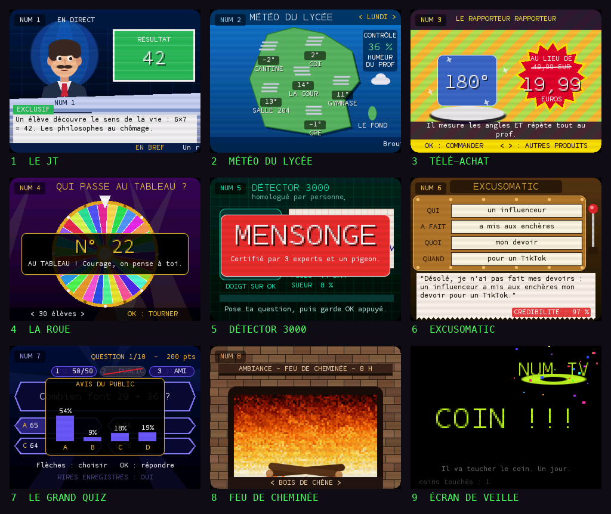

<p align="center">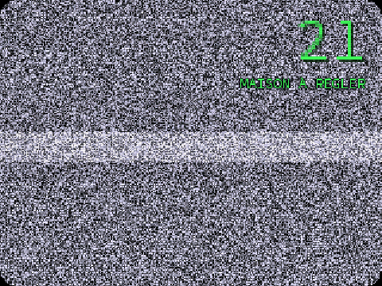</p>

## Ce que fait NUM TV

- **Une vraie télé cathodique.** L'image a des lignes de balayage, des coins
  arrondis, un numéro de chaîne vert en haut à droite. Quand tu zappes : de la
  neige. Quand tu ouvres une appli, **la télé s'éteint** (l'image s'écrase en
  une ligne, puis en un point), et quand tu reviens, elle se rallume.
- **Tes calculs passent au JT.** Tape `6×7` dans Calculs, reviens : la télé
  coupe le programme, « **FLASH SPÉCIAL** : nous interrompons nos programmes
  pour vos calculs », et Gérard Équation, présentateur, lit la nouvelle :

  | Tu calcules… | Au JT… |
  | --- | --- |
  | `6×7` → 42 | « Un élève découvre le sens de la vie. Les philosophes au chômage. » |
  | `6×111` → 666 | « ALERTE : calcul démoniaque détecté en plein cours. Un exorciste est en route. » |
  | `0/0` → undef | « Division interdite. La classe est évacuée, l'univers tient bon. » |
  | `1+1` | « SCANDALE : un lycéen a sorti sa calculatrice pour 1+1. Ses parents réagissent. » |
  | un nombre premier | « EXCLUSIF : il est divisible par personne, et très fier de l'être. » |
  | un nombre énorme | « RECORD : un nombre si grand qu'il ne tient plus dans le JT. » |
  | π | « π aperçu en pleine classe. Il refuse de s'arrêter. » |

  Et `0`, `1`, `7`, `13`, `69`, `404`, `1337`, les carrés parfaits, les
  négatifs, les nombres à virgule… Entre deux calculs, il y a les autres
  infos (« Le 7 aurait mangé le 9. Les autorités confirment : 7 8 9. ») et un
  bandeau qui défile en bas.
- **Le bouton panique.** La touche **Effacer** ouvre **Calculs
  instantanément**, sans animation. Le prof arrive ? Tu es en train de
  calculer, évidemment.
- **L'antenne a sa propre vie.** De temps en temps l'image déraille (neige,
  image qui roule, image déchirée, couleurs inversées). **Tape sur la télé**
  (touche **x,n,t**) : l'écran tremble et, en général, ça remarche. En
  général.
- **Des pubs.** Parfois, en zappant, une page de pub (« AXIOME, le déodorant
  qu'on ne démontre pas : on l'admet. », « Voyages ASYMPTOTE : on vous
  rapproche de votre destination, sans jamais l'atteindre. »). On peut passer
  au bout de 2 secondes. Ou s'abonner à PREMIUM sans pub (0 euro, dans le
  télétexte).
- **Le volume, c'est la luminosité.** `+` et `−` montrent une barre de
  volume verte… et règlent la luminosité de l'écran (la télé est muette).
- **La LED du haut est un voyant « ON AIR ».** Rouge pendant le JT, qui bat
  comme un cœur pendant le détecteur de mensonges, orange qui vacille devant
  le feu de cheminée, arc-en-ciel quand le logo touche le coin, blanche qui
  grésille dans la neige. (Jamais en mode examen, et désactivable.)
- **« Vous êtes toujours là ? »** Laisse la télé seule plus d'une minute :
  elle te le demande, baisse la luminosité, puis passe sur l'écran de veille.
- **Le programme télé** (touche **Retour**) : toutes les chaînes avec leur
  horaire (faux), et **le télétexte** (touche **boîte à outils**) avec les
  touches, les chaînes, l'audimat (zappings, pubs subies, paniques, coups sur
  la télé, coins touchés…) et les réglages.
- **Chaque appli est une émission** (chaînes 10 et plus), avec sa note
  Télé-Calcul : Calculs devient « Questions pour un Calcul », Grapheur « Des
  Courbes et des Lettres », Python « Serpents & Lunettes », Suites « La Suite
  au prochain épisode », Finance « Qui veut gagner des intérêts ? »… Les jeux
  `.nwa` ont aussi leur chaîne (« Soirée jeu vidéo »), cryptée en mode
  examen.
- **Installateurs en un clic pour Mac et pour Windows** : une page web locale
  qui détecte la calculatrice, gère tes jeux et installe tout avec un bouton.
  Sur Windows, un simple `.exe` : ni Python ni pilote à installer.

<p align="center">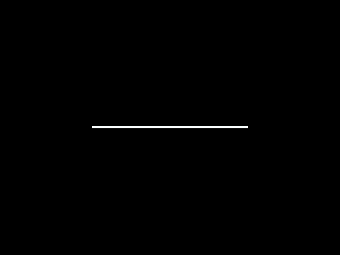</p>

## Les chaînes

| | Chaîne | Ce qu'il y a dessus |
| --- | --- | --- |
| **1** | **LE JT** | tes calculs deviennent l'actualité. ◀ ▶ : info précédente / suivante |
| **2** | **MÉTÉO DU LYCÉE** | la France (l'Hexagone) avec la Cantine, le CDI, la salle 204, le Gymnase, le CPE et la Cour à la place des villes. Risque de contrôle, humeur du prof, pluie de copies. ◀ ▶ : du lundi (brouillard mental) au vendredi (grand soleil) |
| **3** | **TÉLÉ-ACHAT** | le Rapporteur Rapporteur, la Gomme à Bêtises, le Zéro Pointé Antidérapant, le π de Poche… « MAIS ATTENDEZ, CE N'EST PAS TOUT ! ». OK : commander (ça ne marche jamais) |
| **4** | **LA ROUE** | « Qui passe au tableau ? » : ◀ ▶ règle le nombre d'élèves (2 à 40), OK lance la roue. Après 40 : **la roue des gages** (« Parle comme un GPS jusqu'à la sonnerie ») |
| **5** | **DÉTECTOR 3000** | pose une question à ton voisin, il garde le doigt sur OK, l'empreinte est scannée, le polygraphe s'affole… **VÉRITÉ** ou **MENSONGE**. Voir le secret plus bas |
| **6** | **EXCUSOMATIC** | tire le levier : quatre rouleaux fabriquent une excuse certifiée (« Désolé, je n'ai pas fait mes devoirs : un raton laveur a mis aux enchères mon agenda dans une autre dimension. »), avec son taux de crédibilité |
| **7** | **LE GRAND QUIZ** | « Qui veut gagner des points ? » : 10 questions de calcul mental, « c'est votre dernier mot ? », jokers 50/50 (1), avis du public (2) et appel à un ami (3), qui répond souvent juste (« Pourquoi tu m'appelles en plein cours ?! ») |
| **8** | **FEU DE CHEMINÉE** | 8 h de feu pour réviser. ◀ ▶ : bois, copies de maths (elles s'envolent), chimie (flammes vertes), disco |
| **9** | **ÉCRAN DE VEILLE** | le logo rebondit et change de couleur. Un jour, il touchera **pile le coin**. Tout le monde attend |
| **10+** | **LES APPLIS ET LES JEUX** | OK : la télé s'éteint et l'appli s'ouvre |

### Le secret du détecteur de mensonges

Le DÉTECTOR 3000 est truqué, et toi seul le sais. **Avant** que ton ami pose
le doigt sur OK, appuie discrètement sur **◀** : ce sera **VÉRITÉ**. Sur
**▶** : ce sera **MENSONGE**. Sans rien toucher, c'est au hasard. Pour
vérifier, regarde le point à la fin de « homologué par personne. » : blanc
au hasard, vert vérité, rouge mensonge. Personne ne regarde jamais ce point.

## Les commandes

| Touche | Action |
| --- | --- |
| ▲ ▼ | zapper |
| 0 à 9 | taper un numéro de chaîne (le **0** seul : la chaîne précédente) |
| + − | le volume (en vrai : la luminosité) |
| OK | regarder l'émission (ouvrir l'appli), ou agir dans la chaîne |
| ◀ ▶ | dans la chaîne (info suivante, jour de la semaine, produit, nombre d'élèves…) |
| Retour | le programme télé |
| Boîte à outils | le télétexte |
| Ans | zapping au hasard |
| x,n,t | taper sur la télé |
| **Effacer** | **BOUTON PANIQUE** : Calculs, tout de suite |
| Maison | retour au JT |

## Captures

| | |
| --- | --- |
| 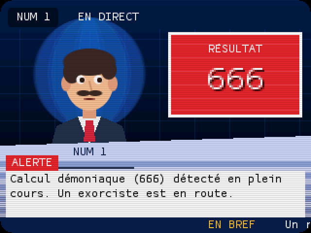 | 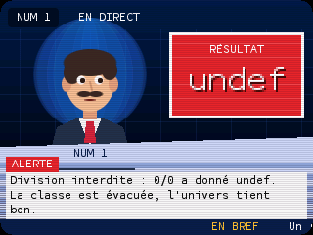 |
| Tu as calculé 6×111 | Tu as calculé 0/0 |
| 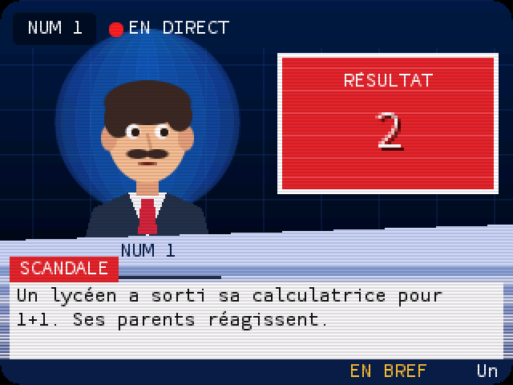 | 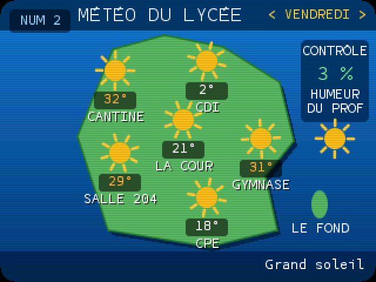 |
| Tu as calculé 1+1 | La météo du vendredi |
| 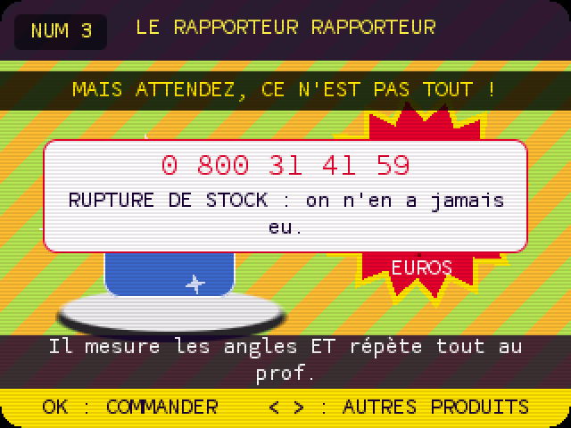 | 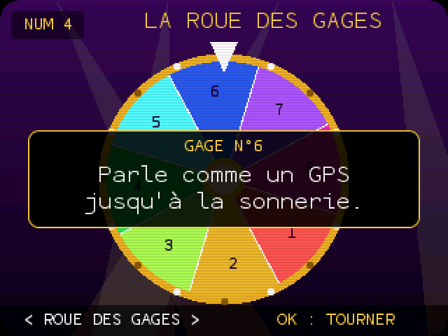 |
| Commander au télé-achat | La roue des gages |
| 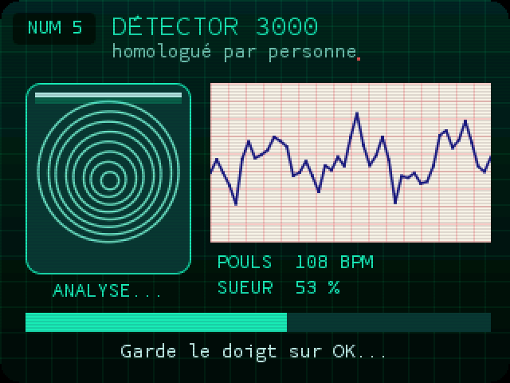 | 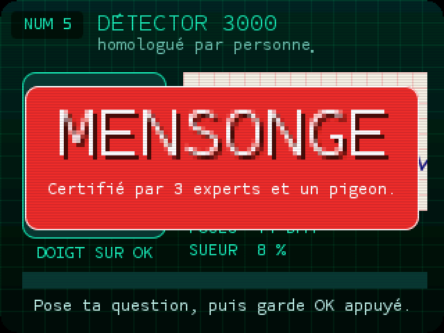 |
| Le scan de l'empreinte | MENSONGE (c'était truqué) |
| 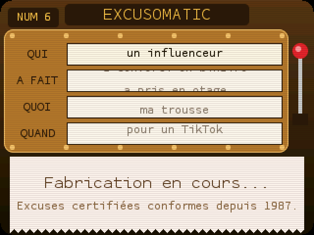 | 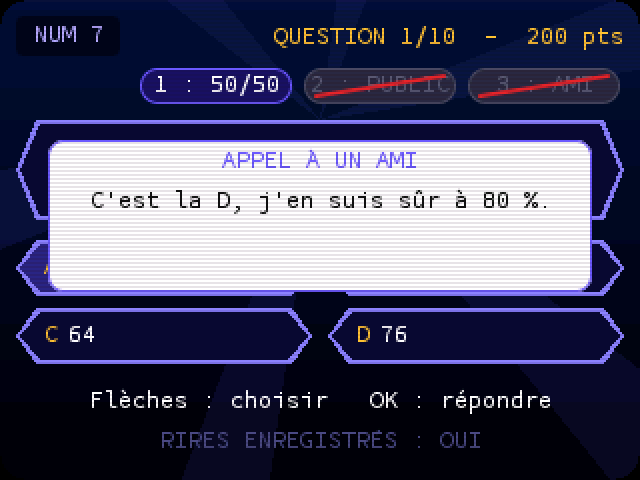 |
| Les rouleaux de l'Excusomatic | L'appel à un ami |
| 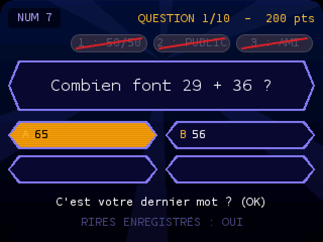 | 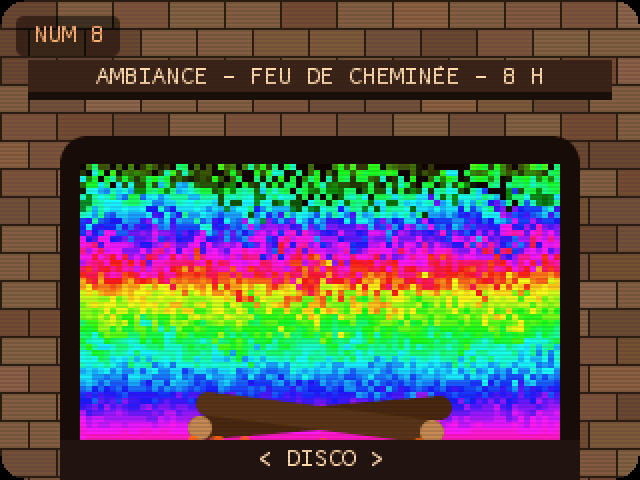 |
| C'est votre dernier mot ? | Le feu de cheminée, version disco |
| 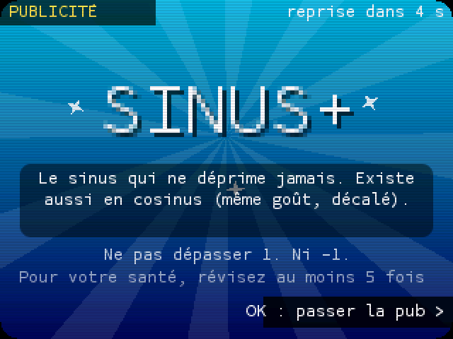 | 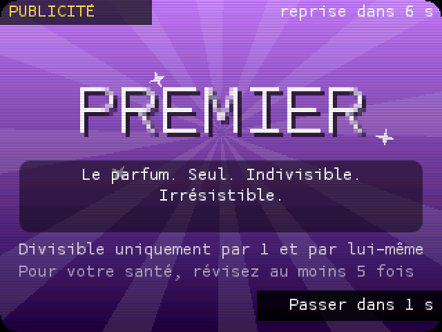 |
| La pub | Encore la pub |
| 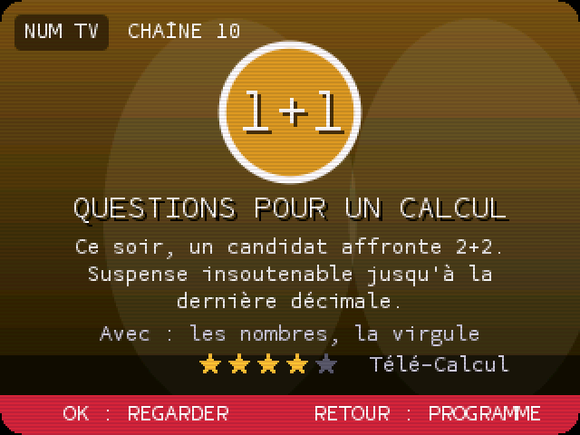 | 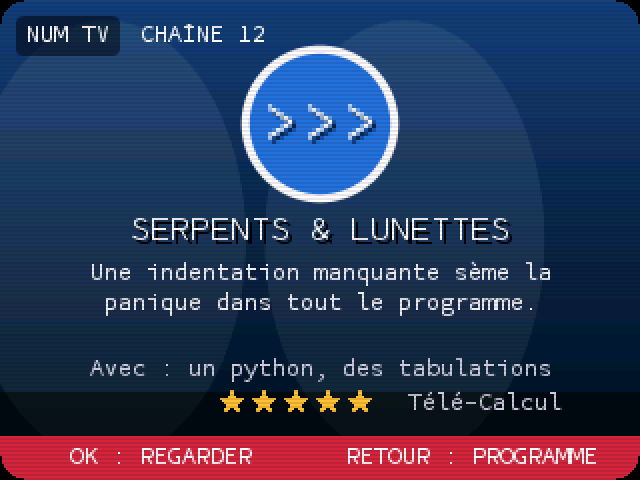 |
| Calculs, chaîne 10 | Python, chaîne 12 |
| 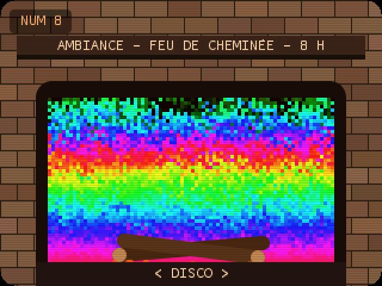 | 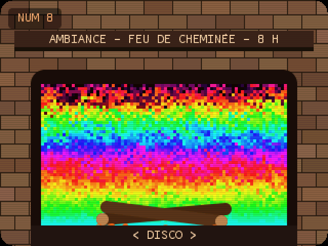 |
| L'antenne capte mal | Tape sur la télé |
| 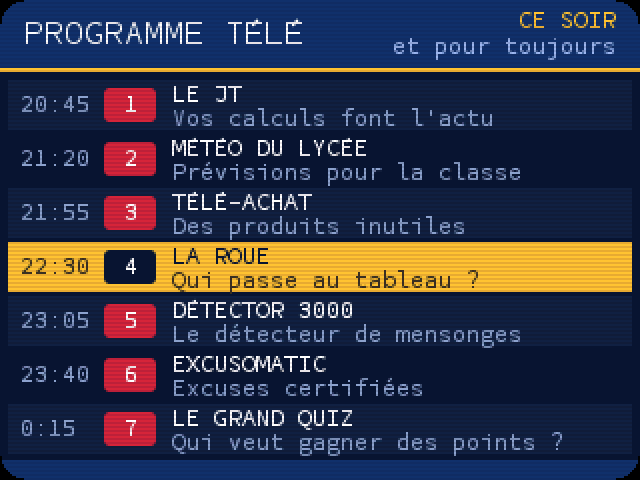 | 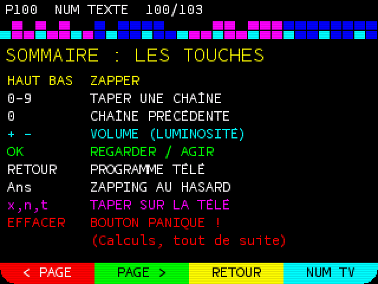 |
| Le programme télé | Le télétexte |
| 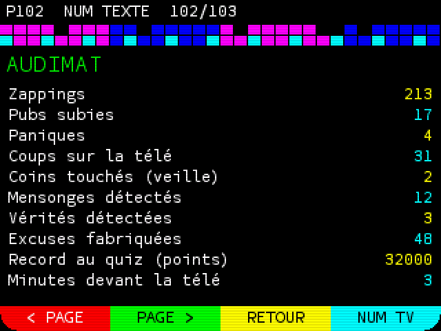 | 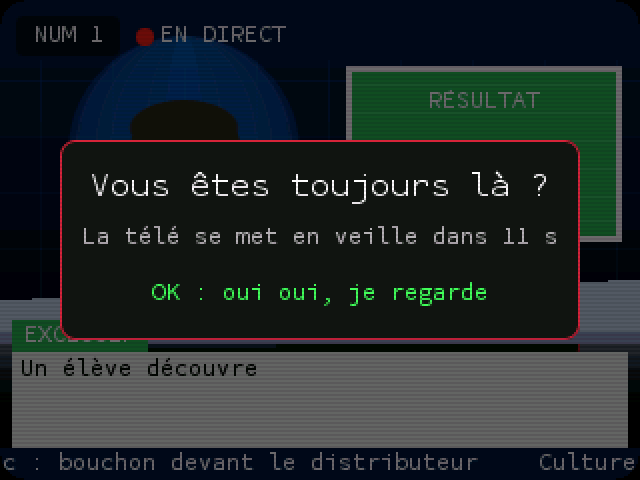 |
| L'audimat | Vous êtes toujours là ? |
| 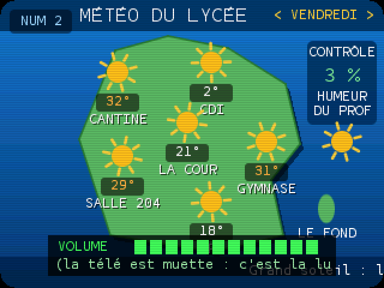 | 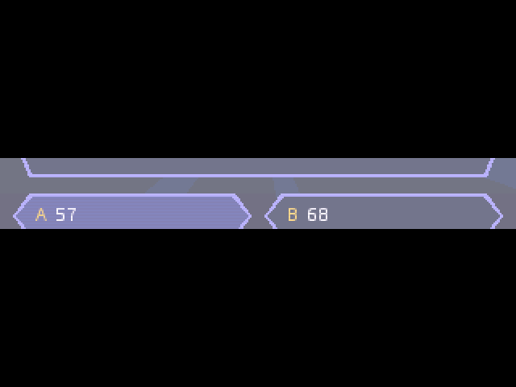 |
| Le volume (la luminosité) | La télé s'éteint, l'appli s'ouvre |

<p align="center">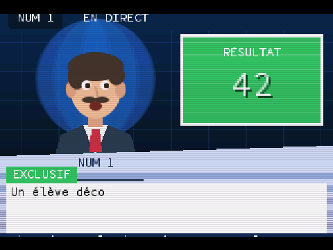</p>

## Installation

### 1. Obtenir NUM TV

Depuis juillet 2021, le code d'Epsilon (le logiciel de la NumWorks) n'est plus
sous licence libre. NUM TV ne publie donc **aucun code ni aucun firmware de
NumWorks** : seulement un **patch** (`patches/numtv-epsilon.patch`) et son
propre code. Le firmware se compile à partir des sources officielles de
NumWorks, dans ton compte GitHub ou sur ton Mac.

**Sans rien compiler (Mac ou Windows)**

1. En haut de cette page : **Use this template** > **Create a new repository**,
   coche **Private** (obligatoire : la compilation refuse de tourner dans un
   dépôt public, pour que le firmware ne soit pas téléchargeable par tous).
2. Facultatif : ajoute tes jeux `.nwa` dans le dossier `games/` de ta copie
   privée (*Add file* > *Upload files*). Ils seront préparés et inclus dans
   l'installateur, et deviendront des chaînes.
3. Dans ta copie : onglet **Actions** > **Build NUM TV** > **Run workflow**.
4. Environ 15 minutes plus tard, en bas de la page de la compilation,
   télécharge **NUMTV-Mac** ou **NUMTV-Windows** et décompresse-le
   (deux fois pour la version Mac : GitHub met le zip dans un zip).

**En compilant sur ton Mac**

```bash
brew install make dfu-util libusb
brew install --cask gcc-arm-embedded
git clone https://github.com/derim00/numtv.git && cd numtv
./scripts/build-firmware.sh
```

Le script télécharge Epsilon au commit indiqué dans `EPSILON_COMMIT`
(Epsilon 26.1, la dernière version publiée par NumWorks), applique le patch,
compile, prépare les jeux de `games/` et remplit le dossier `installer/`.

### 2. Installer sur la calculatrice

**Sur Mac**

1. Une seule fois : `brew install libusb dfu-util` (et
   `brew install --cask gcc-arm-embedded` pour ajouter d'autres jeux).
2. Double-clique sur **`Installer NUM TV.command`** (la première fois :
   clic droit > **Ouvrir**). La page de l'installateur s'ouvre
   (http://127.0.0.1:8770).

**Sur Windows** (rien à installer : ni Python, ni pilote)

1. Décompresse **NUMTV-Windows** (clic droit > *Extraire tout*) : ne
   lance pas l'installateur depuis l'intérieur du zip.
2. Dans le dossier `NUMTV`, double-clique sur **`Installer NUM TV.exe`**
   (si SmartScreen s'affiche : *Informations complémentaires* > *Exécuter
   quand même*). Une fenêtre noire s'ouvre avec la page de l'installateur dans
   ton navigateur : laisse-la ouverte, et ferme-la à la fin pour quitter.

**Ensuite, sur les deux**

3. Branche la calculatrice en USB et appuie sur **Reset** au dos : elle
   redémarre sur le système officiel.
4. Quand le voyant passe au vert, glisse tes jeux `.nwa` dans la page si tu
   veux, puis clique sur **Installer NUM TV**.

L'installateur vérifie que le **slot B** est libre avant d'écrire : le système
officiel (slot A) n'est jamais modifié. Il prépare les jeux pour leur place
dans le slot B (comme le fait le site de NumWorks), les copie, les relit pour
les vérifier, puis installe NUM TV et le démarre.

## À savoir

- **Calculatrice** : NumWorks **n0120**, avec le logiciel officiel
  **26.4.0** dans le slot A. NUM TV est compilé à partir d'Epsilon 26.1 (la
  dernière version publiée) avec le numéro de version 26.4.0.
- **Mémoire** : la télé (la chaîne, les infos, l'audimat, ton record au
  quiz) reste en mémoire quand tu ouvres une appli. Elle repart de zéro après
  un Reset.
- **Le JT** : seuls les résultats calculés depuis le dernier démarrage
  passent aux infos, et seulement les 6 derniers à chaque retour.
- **LED et luminosité** : NUM TV ne touche à la LED et à la luminosité que
  sur son écran ; elles redeviennent normales dès que tu ouvres une appli.
  Tu peux couper la LED, les flashs et les pubs dans le télétexte (page 103,
  touches **1**, **2** et **3**). En mode examen, il n'y touche jamais.
- **Batterie** : la télé est animée en continu ; l'écran de veille tourne
  plus lentement.
- **Après un Reset**, la calculatrice revient sur le système officiel :
  NUM TV reste dans le slot B, il suffit de relancer l'installation.
- **Un seul système dans le slot B** : NUM TV remplace
  [GLOUTON](https://github.com/derim00/glouton),
  [NUMVERSE](https://github.com/derim00/numverse),
  [PSP-OS](https://github.com/derim00/psp-os),
  [Switch-OS](https://github.com/derim00/switch-os) ou
  [Windows-OS](https://github.com/derim00/windows-os) s'il était installé,
  et inversement. Les installateurs peuvent tourner en même temps (ports 8765
  à 8770).
- **Touches Home et On/Off** : sur un logiciel non officiel, le système de la
  calculatrice gère lui-même ces deux touches. NUM TV efface au démarrage le
  point de retour laissé par le système officiel pour que Home ramène à la
  télé ; si la calculatrice revient quand même sur le slot A, utilise
  **Retour** (↩) pour revenir à NUM TV depuis une appli.
- **Mode examen** : NUM TV garde les règles du mode examen d'Epsilon
  (applis interdites, jeux bloqués : leur chaîne est cryptée).
- **Jeux** : seulement des applis `.nwa` dont tu as le droit de te servir, et
  uniquement dans ta copie privée : jamais dans ce dépôt public.

## Comment c'est fait

| Fichier | Rôle |
| --- | --- |
| `patches/numtv-epsilon.patch` | NUM TV (`apps/home/tv`), le branchement des résultats de Calculs, l'animation continue (`escher`), la barre rouge des applis, le correctif Home / On-Off |
| `apps/home/tv/shell.cpp` (dans le patch) | la télé : zapping, neige, tube cathodique (lignes, coins, allumage, extinction), pannes et coups sur la télé, pubs, programme télé, télétexte, volume, LED, « toujours là ? », bouton panique |
| `apps/home/tv/channels.cpp` (dans le patch) | les émissions : le JT et ses infos, la météo, le télé-achat, la roue, le détecteur, l'Excusomatic, le quiz, le feu (un vrai feu simulé), l'écran de veille, les chaînes des applis et les pubs |
| `apps/home/tv/food.cpp` (dans le patch) | les derniers résultats de l'appli Calculs, que le JT lit en revenant |
| `apps/home/tv/gfx.cpp` (dans le patch) | le dessin par bandes de 12 lignes : ellipses et traits lissés, polygones, texte, icônes des jeux |
| `scripts/build-firmware.sh` | télécharge Epsilon, applique le patch, compile, prépare l'installateur |
| `scripts/photos.py` | transforme la séance photo du simulateur en images de ce README |
| `installer/server.py` | serveur local (127.0.0.1 uniquement) de l'installateur, Mac et Windows |
| `installer/dfu_launch.py` | lance l'outil DFU de NumWorks avec libusb (Homebrew ou `libusb-package`) |
| `scripts/build-windows-installer.py` | fait `Installer NUM TV.exe` avec PyInstaller (sur Windows, dans le workflow) et le teste |
| `installer/index.html` | la page de l'installateur |
| `installer/link_games.py` | place chaque jeu `.nwa` à son adresse dans le slot B, comme le site de NumWorks |
| `installer/Installer NUM TV.command` | lanceur en double-clic pour Mac |
| `.github/workflows/build.yml` | compilation dans ta copie privée, avec les deux installateurs |

Le simulateur sait faire une séance photo : compilé pour macOS et lancé avec
`NUMTV_SHOTS=<dossier>` (`Epsilon -h --open-app home`), il enregistre les
images de ce README (ce code n'existe pas dans le firmware de la
calculatrice), que `scripts/photos.py` convertit en PNG et en GIF.

## Licence

Le code de NUM TV est sous licence **CC BY-NC-SA 4.0** (voir `LICENSE`).
Epsilon reste la propriété de NumWorks et n'est pas inclus dans ce dépôt.
NUM TV est un projet de fan, sans lien avec NumWorks ni avec aucune chaîne
de télé : la télé, les émissions, le présentateur, les pubs et les produits
sont inventés.
